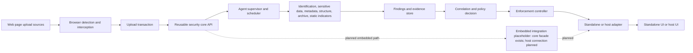
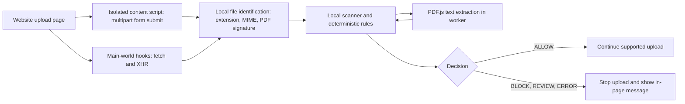

# CommandIQ — Project and Architecture

**Status:** Proof-of-concept snapshot, 12 November 2026. This document distinguishes working repository behavior from planned product architecture.

## Objective

Inspect browser-selected files locally before supported page upload requests proceed. Detect sensitive data and credential-like patterns, return explainable results, and give standalone and future host-extension experiences one reusable engine. This prototype is not an antivirus product and does not guarantee interception of every upload path.

## Decisions

- `ALLOW`: current supported checks completed with no finding.
- `BLOCK`: a high/critical pattern was found.
- `REVIEW`: a finding needs judgment or a format/scan is unsupported or incomplete.
- `ERROR`: inspection failed.

The current extension has no review UI and permits only `ALLOW`; it blocks `REVIEW`, `BLOCK`, and `ERROR`.

## Target system architecture



The target separates browser integration, reusable inspection, specialized analysis, decisions, enforcement, and user experience. Agents should exchange structured findings; a supervisor will schedule work and enforce resource limits. These components are largely planned, not implemented.

### Current proof-of-concept flow



The current extension uses two page-level entry points: an isolated content script handles native multipart form submissions, while a main-world script wraps page `fetch` and XHR calls. Both call the local scanner. The PDF path loads PDF.js and its worker/resources from the extension package. The scan result controls whether supported intercepted requests continue; non-`ALLOW` outcomes are stopped. This is best-effort interception, not a browser-wide guarantee.

## End-to-end upload workflow

### 1. User starts an upload

The user selects a file, drops it on the page, pastes it, or submits a file form in the website as usual. The extension does not ask the user to open a separate CommandIQ page. Selection, drop, and paste events can start a background pre-scan; the decision is enforced when a supported upload request is about to proceed.

### 2. CommandIQ detects and pauses a supported upload

- For a native `multipart/form-data` form, the isolated content script stops the submit event, gathers selected files, and inspects them. It checks that the form and file selection are still present before replaying an allowed submit.
- For page `fetch` and XHR requests, the main-world script inspects `File`, `Blob`, and `FormData` entries before calling the saved native API. Scan results are cached by `File` identity to avoid repeating the same work during selection and send.
- File type identification uses common extensions and MIME types; PDF identification also checks for `%PDF-` in the first 1 KB. File size is checked before reading full content.

Interception only applies to request shapes the current adapters understand. Unsupported body forms, worker/service-worker requests, arbitrary streams, and some `Request`-wrapped bodies can bypass inspection; the current preview must not be represented as universal coverage.

### 3. Scanner inspects locally

The scanner applies the configured resource ceilings: 100 MiB per file, 10 MiB of text, 250 PDF pages, and 10 MiB of extracted PDF text.

- Text-like files are read locally and checked for private-key headers, AWS-style access keys, credential assignments, and email addresses.
- PDFs are parsed by the bundled PDF.js library and matching worker. The scanner extracts selectable text, checks the same text patterns, and checks for JavaScript actions, embedded attachments, interactive fields, and risky link/action annotations. Ordinary safe links do not require review by themselves.
- Other recognized formats are not deeply parsed yet. Image-only PDFs are not OCRed; attachments and active features are not deeply analyzed. Unsupported, oversized, encrypted, malformed, or incomplete scans remain incomplete.

Finding evidence is redacted. The extension does not upload file content to a CommandIQ backend. This local inspection does not change the website’s normal receipt of a file after the extension allows its request.

### 4. Policy chooses the outcome

- `BLOCK`: a high- or critical-severity rule matched, such as a credential pattern.
- `REVIEW`: a medium finding matched, no supported deep parser exists, a PDF contains a feature not fully analyzed, or inspection coverage is incomplete. Email addresses currently count as medium findings, so a resume containing an email can be blocked even when the PDF parsed correctly.
- `ALLOW`: the supported scan completed with no findings.
- An inspection failure stops the supported request; the current form adapter reports an error message rather than allowing the upload to continue.

The decision is separate from enforcement: the adapter resumes only `ALLOW`. It stops `BLOCK` and `REVIEW`, and fails closed if inspection throws.

### 5. User sees the result and continues

- **Allowed file:** the intercepted form or request continues through the website’s original upload flow. The user can keep using the site normally; no separate app window is needed.
- **Blocked or review-required file:** the upload is stopped and an in-page CommandIQ message appears with a close button. Closing the message does not override the decision or restart the upload.
- **Current limitation:** there is no interactive review screen, user override, reason-specific remediation flow, or history view. `REVIEW` currently means “blocked pending a future review experience,” not “the user can review and approve now.”

### Intended future experience

The planned product flow retains the same inspection core but adds a host-controlled experience: `ALLOW` continues automatically; `BLOCK` stops with an actionable reason; `REVIEW` pauses and presents redacted findings and explicit user/policy choices. That interactive review path is planned and is not part of the current proof of concept.

## Current implementation

- TypeScript scanner and framework-independent `createUploadSecurityCore()` facade.
- File identification includes common extensions and PDF detection by extension, MIME type, or `%PDF-` signature in the first 1 KB. A `Blob` renamed by a page can still be recognized as PDF from its MIME/signature.
- Small deterministic text rules detect private-key headers, AWS-style access keys, credential assignments, and email addresses. Evidence values are redacted. Every medium finding currently yields `REVIEW`; a resume containing an email address can therefore be blocked even when PDF extraction completed.
- PDF.js extracts selectable text under the 100 MiB file ceiling, 250-page ceiling, and 10 MiB extracted-text ceiling. The scanner checks JavaScript actions, embedded attachments, interactive fields, and risky link/action annotations. Ordinary HTTP/HTTPS/mailto/tel links do not trigger review by themselves. Image-only pages, incomplete extraction, unsupported active features, or limit breaches return `REVIEW`.
- Chromium Manifest V3 preview: an isolated content script intercepts multipart form submits; main-world wrappers inspect supported `fetch` and XHR bodies. It blocks non-`ALLOW` results and displays an in-page alert dialog.
- PDF diagnostics print decision, extraction coverage, category, notes, and finding rule IDs without logging document text or matched values. `npm run diagnose:pdf` is a headless command-line diagnostic for synthetic samples.
- `test/` includes clean and credential-like text fixtures plus synthetic PDFs for clean text, credential detection, a safe HTTPS link, and a risky JavaScript link. Regenerate PDFs with `node scripts/make-test-pdfs.mjs`.
- No server-side scanning; contents are inspected in the browser.

### Not implemented yet

- Agent supervisor, registry, scheduler, worker pool, investigation dependencies, cancellation, or recovery.
- Deep parsers for Office formats, archives, email containers, images, media, or executable files; PDF OCR and deep embedded-object analysis.
- Configurable policies, review/override workflow, upload history, or a settings interface.
- Versioned public SDK, host-extension adapter, CommandIQ host sample, or cross-extension communication protocol.
- Automated browser integration matrix, framework/provider compatibility suite, performance tests, and formal security review.

### Embedded integration placeholder

`createUploadSecurityCore()` is a starter API boundary, not a connection to a separate extension. It currently offers `inspect()`, lifecycle event subscription, and `shutdown()`. A larger CommandIQ extension could bundle the core. There is no versioned SDK package, host adapter, cross-extension messaging protocol, cancellation API, or sample host extension.

**Future use with CommandIQ:** package the core as a versioned SDK and bundle it into the CommandIQ extension. CommandIQ would pass selected/uploaded `File` objects to the core, receive inspection results/events, then apply its own policy and UI before allowing its upload flow to continue. Bundling shares the scanner without requiring a connection to another installed extension. The placeholder represents this planned boundary only.

## Current limitations

- Text checks are narrow and can produce false positives or miss encoded, split, binary, or format-specific secrets.
- Identifying a file type does not mean it was scanned deeply or found safe.
- Page `fetch`/XHR wrappers are best-effort. Worker contexts, custom streams, transformed bodies, replaced hooks, and non-HTTP paths may bypass them.
- Browser site matching is broad (`<all_urls>`); explain this permission model before distribution.
- No supervisor, independent agents, archive expansion safeguards, configurable policy, review UI, or automated browser integration suite.
- PDF tests cover only small synthetic files. They do not demonstrate compatibility with every PDF producer, encrypted/corrupt PDFs, image-only resumes, embedded files, complex AcroForms, or the PDF variants used by real enterprise applications.
- A normal email address in a PDF is a medium-severity finding and currently causes `REVIEW`, which the headless extension blocks. This behavior is intentional under the current policy; it may be too strict for documents such as resumes and needs an explicit policy decision before broader adoption.
- The CLI diagnostic can show a nonfatal standard-font warning under Node while still extracting text from its synthetic fixtures. The extension build packages PDF.js standard fonts, CMaps, WASM, and its matching worker for browser use.
- The main-world wrapper does not inspect every request-body shape. In particular, arbitrary streams and some `Request`-wrapped bodies may bypass inspection; unsupported bodies must be made explicit and handled safely before production claims.

## Planned enterprise format families

These are product targets, not a claim of current parser support. Each family needs its own parser coverage, resource limits, test fixtures, and explicit incomplete-scan behavior.

- Office documents, spreadsheets, and presentations, including macro-enabled variants.
- PDFs and legacy document formats.
- Text, source code, CSV/TSV, configuration, HTML, XML, JSON, and email containers.
- ZIP and other archive formats, including nested archives with decompression limits.
- Images and media, including metadata extraction where appropriate.
- Executables and scripts using static, non-executing analysis.
- Unknown, encrypted, corrupt, and oversized files, which remain incomplete until safely supported.

## Roadmap (no timeline)

1. **Foundation:** stabilize contracts, boundaries, build, and preview. Partial.
2. **Agent runtime:** registry, scheduler, dependencies, cancellation, resource limits. Not started.
3. **Inspection agents:** format-aware text, metadata, structure, archives, static indicators. Early partial: deterministic text rules and bounded PDF text extraction exist; deeper parsers, OCR, and other agents remain planned.
4. **Correlation and policy:** deduplicate evidence and add configurable decisions. Basic decisions only.
5. **Browser integration:** harden transactions and validate common frameworks/providers and bypasses. Narrow prototype only.
6. **Experiences and SDK:** standalone UI, versioned host SDK, CommandIQ sample adapter. Not started.
7. **Validation and release:** browser, security, performance, parser and permission validation. Not started.

## Run

```powershell
npm install
npm run typecheck
npm run build:extension
```

Load `dist/extension/` as an unpacked extension at `chrome://extensions`. After rebuilding, reload the extension and the target website tabs. The extension needs no local web server.

## Proof-of-concept verification

The current headless diagnostics produce these outcomes for the generated fixtures:

- `clean.pdf` → `ALLOW`
- `fake-credential.pdf` → `BLOCK`
- `clean-link.pdf` → `ALLOW`
- `dangerous-link.pdf` → `REVIEW` (and the extension blocks it)

These are headless PDF.js extraction and rule checks on synthetic samples, plus successful TypeScript and extension builds. They are not automated browser integration tests and do not establish real-site coverage, browser compatibility, or safety for arbitrary enterprise PDFs. For extension-side diagnosis, inspect the website tab’s developer console for `[CommandIQ PDF diagnostic]` after selecting or uploading a PDF.
