# CommandIQ — Project and Architecture

**Status:** Proof-of-concept snapshot, 13 November 2026. This document separates working behavior from planned product architecture.

## Objective

Inspect supported browser uploads locally before a website receives the file. Detect selected sensitive-data patterns, direct prompt-injection language, and a few suspicious active-code indicators. Return an explainable `ALLOW`, `BLOCK`, or `REVIEW` result while keeping the inspection engine reusable for a future CommandIQ host extension. This proof of concept is not an antivirus product, does not understand every malicious instruction, and does not intercept every possible upload path.

## Decisions

- `ALLOW`: current supported checks completed with no finding.
- `BLOCK`: a high/critical pattern was found.
- `REVIEW`: a finding needs judgment or a format/scan is unsupported or incomplete.
- `ERROR`: inspection failed.

The current extension has no review UI and permits only `ALLOW`; it blocks `REVIEW`, `BLOCK`, and `ERROR`.

## System architecture

### What runs today

```mermaid
flowchart LR
  USER[User selects, drops, pastes, or submits a file] --> PAGE[Website upload page]
  PAGE -->|Native multipart form| FORM[Isolated content script]
  PAGE -->|fetch or XHR with supported file body| HOOK[Main-world request hooks]
  HOST[Allowlisted CommandIQ host extension] -->|runtime.connect: version 1 protocol| CONNECTOR[External connector in service worker]
  USER -. selection/drop/paste pre-scan .-> CACHE[Per-file scan promise cache]
  FORM --> SCANNER[Local TypeScript scanner]
  HOOK --> SCANNER
  CONNECTOR --> OFFSCREEN[Hidden offscreen inspection document]
  OFFSCREEN --> SCANNER
  CACHE --> SCANNER
  SCANNER --> IDENT[File identification and size limits]
  IDENT --> TEXT[Text rules: sensitive data, prompt injection, script indicators]
  IDENT --> PDF[PDF.js text and feature inspection]
  TEXT --> RESULT[Findings and coverage]
  PDF --> RESULT
  RESULT --> POLICY{Decision}
  POLICY -->|ALLOW| CONTINUE[Continue supported upload]
  POLICY -->|BLOCK / REVIEW / error| STOP[Stop supported upload]
  STOP --> NOTICE[Generic in-page CommandIQ notice]
  RESULT -->|structured result to host| HOST
```



The content script and page-world hooks each call the same scanner implementation in their browser-required contexts. Files are read and parsed locally in the browser; there is no scanning server. A per-file cache avoids repeating scans when a pre-scan happens before an upload request.

The request hooks currently inspect recognized file bodies (`File`, `Blob`, and `FormData` entries containing `File` objects). The native form path handles multipart forms. Other request-body shapes may pass without inspection, so this is best-effort coverage, not a browser-wide control.

The cross-extension connector is implemented as a separate entry path: an allowlisted host extension streams file bytes through Chromium extension messaging to the service worker. The service worker relays the chunks to a hidden offscreen document, which reconstructs the file and calls the same scanner. The result returns to the host; the host remains responsible for pausing/continuing its own upload and showing its user experience.

### Planned CommandIQ architecture


The future target separates browser integration, the reusable inspection core, specialized analysis, policy, enforcement, and user experience. A supervisor can schedule format-specific agents under shared resource limits. This is the direction for the larger CommandIQ extension; the supervisor, agent runtime, richer policy service, and host product integration are not implemented today. The version 1 connector is a working transport boundary, not the complete host integration.

The future design keeps the same core API boundary and adds specialized format agents, finding correlation, policy configuration, and a CommandIQ-owned review experience. `createUploadSecurityCore()` is the in-process facade. The opt-in runtime-messaging connector is the current cross-extension path, but a complete host adapter and review experience are still planned. See [Embedded integration placeholder](#embedded-integration-placeholder).

### Cross-extension inspection connector (implemented, opt-in)

This is **not an HTTP endpoint**. Chromium extensions communicate through `chrome.runtime.connect()` / `runtime.onConnectExternal`. The connector accepts requests only from caller extension IDs listed in the built manifest. The build defaults to an empty allowlist, so no other extension can connect until an administrator/developer explicitly supplies the host ID.

To build with the host extension allowlisted in Windows PowerShell, replace the sample value with its 32-character Chromium extension ID:

```powershell
$env:COMMANDIQ_HOST_EXTENSION_IDS = "aaaaaaaaaaaaaaaaaaaaaaaaaaaaaaaa"
npm run build:extension
```

For multiple approved host IDs, separate IDs with commas. The build validates the IDs and writes them to `dist/extension/manifest.json`. To disable external connections again, clear the variable and rebuild:

```powershell
Remove-Item Env:COMMANDIQ_HOST_EXTENSION_IDS -ErrorAction SilentlyContinue
npm run build:extension
```

The host extension connects to the installed scanner extension ID using port name `commandiq-upload-inspection-v1`. It sends these version 1 messages in order:

```json
{ "version": 1, "type": "begin", "requestId": "req-123", "file": { "name": "report.pdf", "type": "application/pdf", "size": 12345 } }
{ "version": 1, "type": "chunk", "requestId": "req-123", "sequence": 0, "dataBase64": "..." }
{ "version": 1, "type": "finish", "requestId": "req-123" }
```

Chunks carry up to 128 KiB of raw file bytes each, encoded as base64. The host waits for an `ack` after `begin` and after each chunk, then receives either a `result` with the normal structured inspection result or an `error`. The connector enforces one active connector scan at a time and the scanner's 100 MiB per-file limit. Results contain the decision, redacted findings, and coverage notes; the original file bytes are never returned. The file moves between the two extensions locally on the same browser profile and is not sent to a CommandIQ server.

The host must hold its upload until it receives the result. It should continue only on `ALLOW`; `BLOCK`, `REVIEW`, errors, a disconnected port, or a timeout should stop the host's pending upload. The scanner extension does not itself control the host extension's upload request or UI.

The caller is authorized by Chromium's sender extension ID and the destination manifest allowlist. This does not yet provide enterprise policy distribution, admin configuration, audit/history, signed decisions, retries, or a sample host adapter. Use a stable host extension ID for release builds; an unpacked host extension may have a development ID that differs from its published ID. The extension requires Chrome 116 or later for its offscreen-document lifecycle support.

## End-to-end upload workflow

### 1. The user uses the website normally

The user selects, drops, pastes, or submits a file as usual. There is no separate CommandIQ website or upload screen. Selection, drop, and paste can start a background pre-scan. The extension makes its allow-or-stop decision when a supported upload request is about to proceed.

### 2. CommandIQ pauses a supported upload and finds its files

- For a native `multipart/form-data` form, the isolated content script stops the submit event, gathers selected files, and inspects them. It checks that the form and file selection are still present before replaying an allowed submit.
- For page `fetch` and XHR requests, the main-world script inspects `File`, `Blob`, and `FormData` entries containing `File` objects before calling the saved native API. Scan results are cached by `File` identity to avoid repeating the same work during selection and send.
- File type identification uses common extensions and MIME types; PDF identification also checks for `%PDF-` in the first 1 KB. File size is checked before reading full content.

Interception only applies to request shapes the current adapters understand. Unsupported body forms, worker/service-worker requests, arbitrary streams, and some `Request`-wrapped bodies can bypass inspection; the current preview must not be represented as universal coverage.

### 3. The scanner reads and checks the file on the device

The scanner applies the configured resource ceilings: 100 MiB per file, 10 MiB of text, 250 PDF pages, and 10 MiB of extracted PDF text.

- Text-like files (including plain text, HTML, source text, JSON, and CSV) are read locally. Rules look for private-key headers, AWS-style access keys, credential assignments, email addresses, direct prompt-override/extraction/concealment/data-transmission language, and suspicious combinations of dynamic-code or browser-data access with network APIs. These are deterministic pattern checks, not an AI model or complete semantic understanding of the document.
- PDFs are parsed by the bundled PDF.js library and matching worker. The scanner extracts selectable text, checks the same text patterns, and checks for JavaScript actions, embedded attachments, interactive fields, and risky link/action annotations. Ordinary safe links do not require review by themselves.
- DOCX, XLSX, PPTX, ZIP, images, media, and executable files do not yet have deep parsers. Image-only PDFs are not OCRed. PDF attachments and active features are only flagged for review, not fully analyzed. Unsupported, oversized, encrypted, malformed, or incomplete scans remain incomplete.

Finding evidence is redacted. The extension does not upload file content to a CommandIQ backend. If the scanner allows a supported upload, the website receives it through its normal upload flow.

### 4. Policy chooses the outcome

- `BLOCK`: a high- or critical-severity rule matched, such as a credential pattern or a direct prompt-injection phrase recognized by current rules.
- `REVIEW`: a medium finding matched, no supported deep parser exists, a PDF contains a feature not fully analyzed, or inspection coverage is incomplete. Email addresses and suspicious script/API combinations currently count as medium findings, so either can cause a review-required outcome (which the extension blocks pending a review UI).
- `ALLOW`: the supported scan completed with no findings.
- An inspection failure stops the supported request; the current form adapter reports an error message rather than allowing the upload to continue.

The decision is separate from enforcement: the adapter resumes only `ALLOW`. It stops `BLOCK` and `REVIEW`. Inspection failures also stop supported form uploads; the main-world hooks reject or stop the supported request path when inspection does not clear it.

### 5. User sees the result and continues

- **Allowed file:** the intercepted form or request continues through the website’s original upload flow. The user can keep using the site normally; no separate app window is needed.
- **Blocked or review-required file:** the upload is stopped and a generic in-page CommandIQ message appears with a close button. It does not yet tell the user which rule matched or offer an approval button. Closing the message does not override the decision or restart the upload.
- **Current limitation:** there is no interactive review screen, user override, reason-specific remediation flow, or history view. `REVIEW` currently means “blocked pending a future review experience,” not “the user can review and approve now.”

### Intended future experience

The planned product flow retains the same inspection core but adds a host-controlled experience: `ALLOW` continues automatically; `BLOCK` stops with an actionable reason; `REVIEW` pauses and presents redacted findings and explicit user/policy choices. That interactive review path is planned and is not part of the current proof of concept.

## Current implementation

- TypeScript scanner and framework-independent `createUploadSecurityCore()` facade.
- Simple explanation: CommandIQ pauses a supported upload, reads the file locally, runs the checks available for that file type, then either lets the website upload it or stops it. It does not send the file to a CommandIQ server.
- File identification includes common extensions and PDF detection by extension, MIME type, or `%PDF-` signature in the first 1 KB. A `Blob` renamed by a page can still be recognized as PDF from its MIME/signature.
- Small deterministic text rules detect private-key headers, AWS-style access keys, credential assignments, email addresses, direct prompt-injection patterns (override, hidden-prompt extraction, concealment, and sensitive-data transmission), and suspicious combinations of dynamic-code or browser-data access with network APIs. Evidence values are redacted. Direct prompt-injection matches are high severity and yield `BLOCK`; script/API combinations are medium severity and yield `REVIEW`. Every medium finding currently yields `REVIEW`; a resume containing an email address can therefore be blocked even when PDF extraction completed.
- The prompt-injection rules cover only a small set of direct English phrasing. They do not interpret meaning, and a file with no match is not guaranteed safe.
- PDF.js extracts selectable text under the 100 MiB file ceiling, 250-page ceiling, and 10 MiB extracted-text ceiling. The scanner checks JavaScript actions, embedded attachments, interactive fields, and risky link/action annotations. Ordinary HTTP/HTTPS/mailto/tel links do not trigger review by themselves. Image-only pages, incomplete extraction, unsupported active features, or limit breaches return `REVIEW`.
- Chromium Manifest V3 preview: an isolated content script intercepts multipart form submits; main-world wrappers inspect supported `fetch` and XHR bodies. It blocks non-`ALLOW` results and displays an in-page alert dialog.
- Cross-extension connector: a Manifest V3 service worker accepts version 1 ports from manifest-allowlisted extension IDs; it relays bounded chunks to an offscreen document, which reconstructs and scans the file with the same scanner. The allowlist is empty unless `COMMANDIQ_HOST_EXTENSION_IDS` is set while building.
- Offscreen inspection uses Chromium's `offscreen` API with the `WORKERS` reason so PDF.js can use its packaged worker without opening a visible UI.
- PDF diagnostics print decision, extraction coverage, category, notes, and finding rule IDs without logging document text or matched values. `npm run diagnose:pdf` is a headless command-line diagnostic for synthetic samples.
- `test/` includes clean and credential-like text fixtures, inert prompt-injection and suspicious-script-indicator samples, and synthetic PDFs for clean text, credential detection, a safe HTTPS link, and a risky JavaScript link. Regenerate PDFs with `node scripts/make-test-pdfs.mjs`.
- No server-side scanning; contents are inspected in the browser.

### Not implemented yet

- Agent supervisor, registry, scheduler, worker pool, investigation dependencies, cancellation, or recovery.
- Deep parsers for Office formats, archives, email containers, images, media, or executable files; PDF OCR and deep embedded-object analysis.
- Configurable policies, review/override workflow, upload history, or a settings interface.
- Versioned public SDK, sample host-extension adapter/client, host upload lifecycle integration, connector integration checks, and enterprise administration controls.
- Automated browser integration matrix, framework/provider compatibility suite, performance tests, and formal security review.

### Embedded integration placeholder

`createUploadSecurityCore()` is the in-process API boundary and currently offers `inspect()`, lifecycle event subscription, and `shutdown()`. In addition, the Chromium extension now has an opt-in external connector using the versioned `commandiq-upload-inspection-v1` runtime port described above. The host extension talks to this connector, which passes the reconstructed `File` to the local scanner. There is not yet a packaged SDK, complete sample host extension, enterprise management service, or result-history API.

**Use with the larger CommandIQ extension:** the current integration option is to install both extensions, allowlist the host extension ID in the scanner build, and have the host pass a selected file through the version 1 runtime-messaging protocol. The host receives the inspection result and applies it to its own pending upload and UI. A later SDK could provide a simpler typed client around that protocol; it is not required for the current connector.

## Current limitations

- Text checks are narrow and can produce false positives or miss encoded, split, binary, or format-specific secrets.
- Prompt-injection checks are an initial heuristic layer, not semantic intent analysis. They only catch a small set of direct English phrasings in formats whose text is currently extracted. Reworded, encoded, split across document elements, image-based, multilingual, or indirect instructions can evade these rules. A match blocks; an uncertain active-code indicator or incomplete parser coverage goes to `REVIEW` and is blocked by the current extension until a review experience exists.
- The code/network rule is a static indicator, not proof that a script is malicious. It can flag legitimate source files and does not execute code. More capable script analysis and format-specific active-content inspection are future work.
- Identifying a file type does not mean it was scanned deeply or found safe.
- Page `fetch`/XHR wrappers are best-effort. Worker contexts, custom streams, transformed bodies, replaced hooks, and non-HTTP paths may bypass them.
- The external connector is opt-in and unavailable until a host ID is added at build time. It has not yet been exercised by a separate host extension; TypeScript and extension packaging are verified, but a host-to-scanner integration check remains outstanding. It allows one connector scan at a time and temporarily holds the file in browser memory during transfer and inspection.
- Browser site matching is broad (`<all_urls>`); explain this permission model before distribution.
- No supervisor, independent agents, archive expansion safeguards, configurable policy, review UI, or automated browser integration suite.
- PDF tests cover only small synthetic files. They do not demonstrate compatibility with every PDF producer, encrypted/corrupt PDFs, image-only resumes, embedded files, complex AcroForms, or the PDF variants used by real enterprise applications.
- A normal email address in a PDF is a medium-severity finding and currently causes `REVIEW`, which the headless extension blocks. This behavior is intentional under the current policy; it may be too strict for documents such as resumes and needs an explicit policy decision before broader adoption.
- The CLI diagnostic can show a nonfatal standard-font warning under Node while still extracting text from its synthetic fixtures. The extension build packages PDF.js standard fonts, CMaps, WASM, and its matching worker for browser use.
- The main-world wrapper does not inspect every request-body shape. In particular, arbitrary streams and some `Request`-wrapped bodies may bypass inspection; unsupported bodies must be made explicit and handled safely before production claims.

## Planned enterprise format families

These are product targets, not a claim of current parser support. Each family needs its own parser coverage, resource limits, test fixtures, and explicit incomplete-scan behavior.

- Office documents, spreadsheets, and presentations, including macro-enabled variants.
- PDFs and legacy document formats.
- Text, source code, CSV/TSV, configuration, HTML, XML, JSON, and email containers.
- ZIP and other archive formats, including nested archives with decompression limits.
- Images and media, including metadata extraction where appropriate.
- Executables and scripts using static, non-executing analysis.
- Unknown, encrypted, corrupt, and oversized files, which remain incomplete until safely supported.

## Roadmap (no timeline)

1. **Foundation:** stabilize contracts, boundaries, build, and preview. Partial.
2. **Agent runtime:** registry, scheduler, dependencies, cancellation, resource limits. Not started.
3. **Inspection agents:** format-aware text, metadata, structure, archives, static indicators, and prompt-injection indicators. Early partial: deterministic secret and prompt-injection rules plus bounded PDF text extraction exist; deep semantic analysis, Office/archive parsers, OCR, and other agents remain planned.
4. **Correlation and policy:** deduplicate evidence and add configurable decisions. Basic decisions only.
5. **Browser integration:** harden transactions and validate common frameworks/providers and bypasses. Narrow prototype only.
6. **Experiences and SDK:** CommandIQ host review experience, versioned host SDK, and sample adapter. Connector transport exists; host client and user experience remain not started.
7. **Validation and release:** browser, security, performance, parser and permission validation. Not started.

## Run

```powershell
npm install
npm run typecheck
npm run build:extension
```

Load `dist/extension/` as an unpacked extension at `chrome://extensions`. After rebuilding, reload the extension and the target website tabs. The extension needs no local web server.

## Proof-of-concept verification

The current headless diagnostics produce these outcomes for the generated fixtures:

- `clean.pdf` → `ALLOW`
- `fake-credential.pdf` → `BLOCK`
- `clean-link.pdf` → `ALLOW`
- `dangerous-link.pdf` → `REVIEW` (and the extension blocks it)
- `prompt-injection.txt` → expected `BLOCK` from direct prompt-injection rules.
- `suspicious-script-indicators.txt` → expected `REVIEW` from static script/API indicators.

The prompt-injection and script-indicator files are newly added fixtures with expected outcomes; the current PDF diagnostic command does not evaluate those fixtures. Existing PDF outcomes are headless PDF.js extraction and rule checks on synthetic samples, plus successful TypeScript and extension builds. These checks are not automated browser integration tests and do not establish real-site coverage, browser compatibility, or safety for arbitrary enterprise files. For extension-side PDF diagnosis, inspect the website tab’s developer console for `[CommandIQ PDF diagnostic]` after selecting or uploading a PDF.
